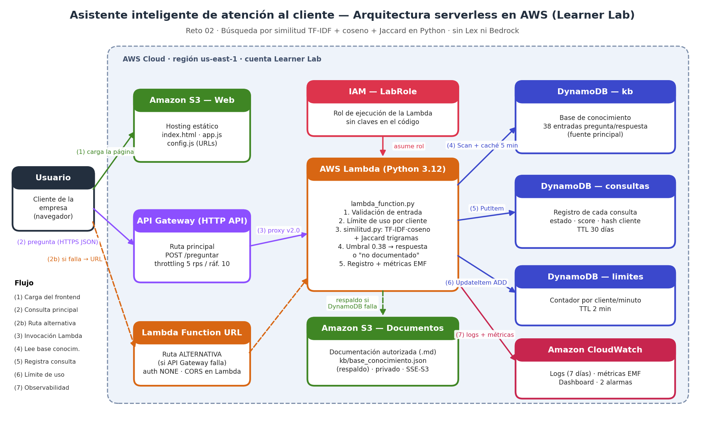

# Asistente inteligente de atención al cliente — Reto 02

**Proyecto Final · Computación en la Nube · Universidad Católica Boliviana**
Autora: Daniela Alejandra Caro Arrazola · daniela.caro@ucb.edu.bo · Video de respaldo: [enlace]

Asistente web que responde consultas frecuentes de clientes (productos, políticas, horarios y procedimientos) **solo con base en documentación autorizada**, usando búsqueda por similitud de texto implementada en Python. Cuando la documentación no contiene la respuesta, lo reconoce, lo informa al usuario y registra la consulta para que el equipo la revise.

> La empresa **Liberate S.A.** y todos sus datos son **ficticios y sintéticos**, creados para este proyecto.

---

## Arquitectura



| Servicio | Rol en la solución |
|---|---|
| **Amazon S3** (2 buckets) | `web`: hosting estático del chat. `docs`: documentación autorizada (.md) y respaldo JSON de la base de conocimiento (privado, cifrado, versionado). |
| **API Gateway** (HTTP API) | Ruta principal `POST /preguntar`, con throttling global (5 rps, ráfaga 10). |
| **Lambda Function URL** | **Ruta alternativa** si API Gateway falla. El frontend conmuta automáticamente. |
| **AWS Lambda** (Python 3.12) | Valida, aplica límite por cliente, calcula similitud (TF-IDF + coseno + Jaccard), decide con umbral, registra y emite métricas. |
| **DynamoDB** (3 tablas) | `kb` (base de conocimiento), `consultas` (registro con TTL 30 días), `limites` (contador por cliente/minuto). |
| **CloudWatch** | Logs (retención 7 días), métricas personalizadas vía EMF, dashboard y 2 alarmas. |
| **IAM – LabRole** | Rol de ejecución de la Lambda. Ninguna credencial en el código. |

Detalle y justificación de cada servicio: [docs/arquitectura.md](docs/arquitectura.md).

### Cómo decide el asistente

```
score = (0.55·coseno_TFIDF_mejor_variante + 0.25·coseno_TFIDF_entrada + 0.20·Jaccard_trigramas) × factor_cobertura

score ≥ 0.38          → respondida      (respuesta + documento fuente)
0.22 ≤ score < 0.38   → sugerencia      ("no tengo certeza, ¿te refieres a…?")
score < 0.22          → sin_respuesta   ("la documentación no contiene esa información")
```

El texto se normaliza (minúsculas, sin tildes, sin palabras vacías, sinónimos de dominio y *stemming* ligero en español). El **factor de cobertura** penaliza preguntas con palabras que no existen en la documentación (p. ej. "wifi", "vacantes"), lo que evita falsos positivos.

---

## Estructura del repositorio

```
asistente-atencion-cliente/
├── README.md
├── .gitignore                       # excluye credenciales del lab, config.js y salidas
├── requirements-dev.txt             # solo pruebas locales (la Lambda no tiene dependencias)
├── src/asistente/                   # código de la Lambda (se empaqueta tal cual en un .zip)
│   ├── lambda_function.py           # handler: rutas, validación, errores, orquestación
│   ├── similitud.py                 # motor TF-IDF + coseno + Jaccard (Python puro)
│   ├── base_conocimiento.py         # carga desde DynamoDB (o S3 de respaldo) con caché
│   ├── registro.py                  # registro en DynamoDB + métricas CloudWatch (EMF)
│   └── limites.py                   # límite de uso por cliente
├── frontend/                        # sitio estático para S3
│   ├── index.html · app.js · styles.css
│   └── config.example.js            # plantilla; deploy.sh genera config.js
├── data/
│   ├── documentos/*.md              # documentación autorizada (sintética)
│   ├── base_conocimiento.json       # 38 entradas pregunta/respuesta con su fuente
│   └── casos_prueba.json            # casos de la prueba de aceptación y de error
├── infra/
│   ├── config.env                   # nombres de recursos y parámetros (sin secretos)
│   ├── deploy.sh                    # despliegue completo con AWS CLI (idempotente)
│   ├── cleanup.sh                   # elimina todo y muestra evidencia de limpieza
│   ├── dashboard.json               # dashboard de CloudWatch
│   └── politicas/*.json             # política del bucket web y de recursos de Lambda
├── scripts/
│   ├── cargar_base_conocimiento.py  # carga data/base_conocimiento.json en DynamoDB
│   ├── prueba_aceptacion.py         # ejecuta la prueba de aceptación y guarda evidencias
│   ├── consultas_sin_respuesta.py   # reporte de consultas no respondidas
│   └── generar_diagrama.py          # regenera docs/arquitectura.png/.pdf
├── tests/                           # 43 pruebas (pytest + moto, sin AWS real)
├── docs/
│   ├── arquitectura.png / .pdf / .md
│   ├── guia_consola_aws.md          # despliegue manual paso a paso en la consola
│   ├── borrador_informe.md          # borrador del PDF según la rúbrica
│   └── guion_video.md               # guion del video de respaldo (5 min)
└── evidencias/                      # capturas y resultados de pruebas
```

---

## Requisitos

- Cuenta de **AWS Academy Learner Lab** activa (región `us-east-1`), con el rol `LabRole`.
- **AWS CloudShell** (recomendado: ya tiene AWS CLI v2, Python 3, boto3 y `zip`), o una terminal local con AWS CLI v2 y Python 3.10+.
- Navegador moderno para el frontend.

> 🔐 **Credenciales**: no se necesita ninguna en el código. En CloudShell la sesión es automática. Si trabajas en local, pega las credenciales temporales de *AWS Details* únicamente en `~/.aws/credentials` (fuera del repositorio). El `.gitignore` bloquea archivos de credenciales por si acaso.

---

## Despliegue rápido (AWS CLI, ~3 minutos)

1. Inicia el Learner Lab (**Start Lab**) y espera el indicador verde. Abre la consola → **CloudShell**.
2. Clona y despliega:
   ```bash
   git clone https://github.com/<usuario>/asistente-atencion-cliente.git
   cd asistente-atencion-cliente
   bash infra/deploy.sh
   ```
3. Al final se imprimen las tres URLs: **frontend**, **API Gateway** y **URL de función**.

El script crea buckets, tablas, carga la documentación y la base de conocimiento, crea la Lambda con `LabRole`, la HTTP API con throttling, la URL de función con sus permisos, publica el frontend y crea el dashboard y las alarmas de CloudWatch. Es idempotente: puedes volver a ejecutarlo para actualizar código o datos.

**Despliegue manual en la consola:** sigue [docs/guia_consola_aws.md](docs/guia_consola_aws.md).

---

## Ejecutar la prueba de aceptación

```bash
source infra/salidas.env
python3 scripts/prueba_aceptacion.py --url "$API_URL"     # ruta principal
python3 scripts/prueba_aceptacion.py --url "$FN_URL"      # ruta alternativa
```

Ejecuta 22 preguntas (14 cubiertas por la documentación y 8 que no lo están) más 3 casos de error, y guarda el resultado en `evidencias/prueba_aceptacion_<origen>_<fecha>.md/.json`. Se aprueba cuando:

- las 14 preguntas documentadas devuelven `respondida` con la entrada correcta, y
- las 8 no documentadas devuelven `sin_respuesta` o `sugerencia` (nunca una respuesta inventada), y
- los errores devuelven HTTP 400/413.

Prueba manual con `curl`:

```bash
curl -s -X POST "$API_URL/preguntar" -H 'Content-Type: application/json' \
     -d '{"pregunta":"¿Aceptan pagos con QR?"}' | python3 -m json.tool
curl -s -X POST "$API_URL/preguntar" -H 'Content-Type: application/json' \
     -d '{"pregunta":"¿Tienen vacantes de trabajo?"}' | python3 -m json.tool
```

Límite de uso (debe aparecer HTTP 429 a partir de la consulta 31 del mismo minuto):

```bash
for i in $(seq 1 35); do curl -s -o /dev/null -w "%{http_code} " -X POST "$FN_URL/preguntar" \
  -H 'Content-Type: application/json' -d '{"pregunta":"horario"}'; done; echo
```

Consultas sin respuesta registradas:

```bash
python3 scripts/consultas_sin_respuesta.py --tabla asistente-tecnohogar-consultas --csv evidencias/sin_respuesta.csv
```

### Pruebas locales (sin AWS)

```bash
pip install -r requirements-dev.txt
python3 -m pytest -q                           # 43 pruebas con DynamoDB/S3 simulados (moto)
python3 scripts/prueba_aceptacion.py --local   # prueba de aceptación contra el handler local
```

---

## API

`POST /preguntar` — cuerpo `{"pregunta": "texto (máx. 500 caracteres)"}`

```json
{
  "estado": "respondida",
  "score": 0.7131,
  "umbral": 0.38,
  "respuesta": "Aceptamos efectivo (solo en sucursales), tarjetas de débito y crédito…",
  "entrada_id": "PAG-001",
  "categoria": "productos",
  "pregunta_relacionada": "¿Qué medios de pago aceptan?",
  "fuente": "documentos/03_productos_precios_pagos.md#3-medios-de-pago-aceptados",
  "fuente_base": "dynamodb",
  "consulta_id": "7d0c…",
  "latencia_ms": 41.2
}
```

| HTTP | Cuándo |
|---|---|
| 200 | Consulta procesada (`estado`: `respondida`, `sugerencia` o `sin_respuesta`) |
| 400 | JSON inválido o `pregunta` vacía |
| 404 | Ruta o método no soportado |
| 413 | Pregunta de más de 500 caracteres |
| 429 | Límite de consultas por minuto excedido (`Retry-After: 60`) |
| 500 | Error interno (detalle solo en CloudWatch Logs) |

`GET /salud` → `{"estado":"ok","entradas":23,"fuente_base":"dynamodb"}`

### Variables de entorno de la Lambda

| Variable | Valor por defecto | Descripción |
|---|---|---|
| `KB_SOURCE` | `dynamodb` | `dynamodb`, `s3` o `local` |
| `KB_TABLE` / `LOG_TABLE` / `RATE_TABLE` | — | Nombres de las tablas |
| `DOCS_BUCKET` / `KB_S3_KEY` | — / `kb/base_conocimiento.json` | Respaldo en S3 |
| `UMBRAL_RESPUESTA` / `UMBRAL_SUGERENCIA` | `0.38` / `0.22` | Umbrales de decisión |
| `LIMITE_POR_MINUTO` | `30` | Consultas por cliente por minuto |
| `MAX_CARACTERES` | `500` | Longitud máxima de la pregunta |
| `ALLOWED_ORIGIN` | `*` | Origen CORS permitido (URL del frontend) |
| `LOG_TTL_DIAS` | `30` | Días que se conservan las consultas |
| `DEBUG_SIMILITUD` | `false` | `true` agrega detalle del cálculo en la respuesta |

---

## Actualizar la documentación autorizada

1. Edita `data/documentos/*.md` y agrega o modifica la entrada en `data/base_conocimiento.json` (con `variantes` y `fuente`).
2. Ejecuta `python3 -m pytest -q` para verificar que la prueba de aceptación sigue pasando.
3. `bash infra/deploy.sh` (la Lambda recarga la base en ≤ 5 minutos por la caché).

## Limpieza

```bash
bash infra/cleanup.sh
```

Elimina todos los recursos (incluye vaciar los buckets versionados) y muestra un listado final vacío para usar como evidencia.

## Limitaciones conocidas

- La similitud es léxica: no entiende sinónimos fuera del diccionario de `similitud.py` ni preguntas muy indirectas. Las consultas de baja confianza se devuelven como *sugerencia* en vez de arriesgar una respuesta incorrecta.
- El frontend se sirve por HTTP (endpoint de sitio web de S3); en producción se usaría CloudFront con HTTPS.
- Las URLs de la API son públicas (sin autenticación), mitigado con throttling, límite por cliente y validación de entrada.
