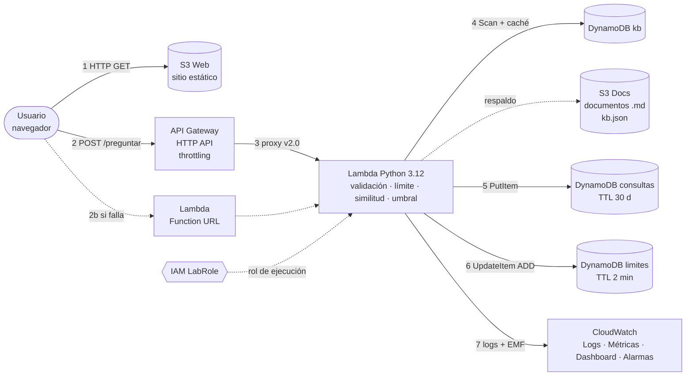

# Arquitectura

Regenerar la imagen: `python3 scripts/generar_diagrama.py` (también produce `arquitectura.pdf`).

## 1. Componentes

| # | Componente | Recurso | Configuración clave |
|---|---|---|---|
| C1 | Frontend | S3 `asistente-tecnohogar-web-<CUENTA>` | Static website hosting, política solo `s3:GetObject` |
| C2 | API principal | API Gateway HTTP API `asistente-tecnohogar-api` | Integración Lambda proxy (payload 2.0), throttling 5 rps / ráfaga 10 |
| C3 | API alternativa | Lambda Function URL | Auth NONE, CORS en la Lambda |
| C4 | Lógica | Lambda `asistente-tecnohogar-fn` | Python 3.12, 256 MB, 10 s, rol **LabRole**, 0 dependencias externas |
| C5 | Base de conocimiento | DynamoDB `…-kb` (PK `id`) | On-demand. 23 entradas: pregunta, variantes, palabras clave, respuesta, fuente |
| C6 | Registro de consultas | DynamoDB `…-consultas` (PK `consulta_id`) | On-demand, TTL 30 días, IP guardada solo como hash |
| C7 | Límite de uso | DynamoDB `…-limites` (PK `clave`) | Contador atómico por cliente/minuto, TTL 2 min |
| C8 | Documentación autorizada | S3 `asistente-tecnohogar-docs-<CUENTA>` | Privado, SSE-S3, versionado. `documentos/*.md` + `kb/base_conocimiento.json` (respaldo) |
| C9 | Observabilidad | CloudWatch Logs, Metrics, Dashboard, Alarms | Retención 7 días, métricas EMF, 2 alarmas |
| C10 | Identidad | IAM LabRole | Rol de ejecución preexistente del Learner Lab |

## 2. Flujo de datos

1. **Carga del frontend**: el navegador descarga `index.html`, `app.js`, `styles.css` y `config.js` desde el endpoint web de S3 (C1).
2. **Consulta**: el usuario escribe una pregunta; `app.js` envía `POST /preguntar {"pregunta": "…"}` a API Gateway (C2).
   - **2b. Ruta alternativa**: si la llamada falla (error de red, 403 o 5xx), `app.js` reintenta automáticamente contra la URL de función (C3). La etiqueta del chat muestra qué ruta se usó.
3. **Invocación**: API Gateway (o la URL de función) invoca la Lambda (C4) con un evento en formato 2.0. La Lambda asume **LabRole** (C10).
4. **Validación**: JSON válido, pregunta no vacía, ≤ 500 caracteres (400/413 si no).
5. **Límite de uso**: `UpdateItem ADD conteo :1` en C7 con clave `hash(IP)#minuto`; si supera 30 → HTTP 429.
6. **Búsqueda**: la Lambda obtiene el índice TF-IDF desde la caché del contenedor; si expiró (5 min) hace `Scan` de C5 y lo reconstruye. Si DynamoDB falla, lee el respaldo JSON de C8.
7. **Decisión**: calcula el score de cada entrada y aplica los umbrales → `respondida` / `sugerencia` / `sin_respuesta`.
8. **Registro**: `PutItem` en C6 con pregunta, estado, score, entrada, latencia, origen y hash del cliente.
9. **Métricas**: imprime una línea EMF; CloudWatch (C9) la convierte en métricas y alimenta dashboard y alarmas.
10. **Respuesta**: JSON con la respuesta, su **fuente** (documento y sección) y el `consulta_id`.

## 3. Diagrama como código (Mermaid)

Pégalo en <https://mermaid.live> o en un bloque `mermaid` de GitHub para obtener una versión alternativa.

## 4. Justificación de servicios y alternativas descartadas

| Servicio elegido | Por qué | Alternativa descartada y motivo |
|---|---|---|
| **S3 (hosting web)** | Sin servidores, costo casi nulo, despliegue con un `sync`. Requerido por el reto. | **EC2 + Nginx**: hay que administrar, parchear y pagar una instancia encendida. **Amplify Hosting**: no garantizado en el Learner Lab. **CloudFront**: daría HTTPS, pero agrega complejidad y tiempo de propagación innecesarios para la demo (se propone para producción). |
| **S3 (documentos)** | Almacenamiento durable (11 nueves) y versionado de la documentación autorizada; respaldo de la base de conocimiento. | **EFS**: requiere VPC y es más caro. **Guardar documentos dentro del .zip de la Lambda**: obliga a redesplegar código para cambiar contenido. |
| **API Gateway HTTP API** | Endpoint HTTPS administrado, throttling incorporado, ~70 % más barato y con menor latencia que REST API. | **REST API**: funciones extra (API keys, planes de uso, validación de modelos) que no se necesitan y mayor costo. **ALB**: cobra por hora aunque no haya tráfico. |
| **Lambda Function URL** | Ruta alternativa exigida por el reto: HTTPS directo a la Lambda sin otro servicio; mismo formato de evento, por lo que el código no cambia. | **Invocar Lambda con el SDK desde el navegador**: exigiría credenciales en el cliente (inseguro). |
| **Lambda (Python)** | Pago por invocación, escala a cero, arranque rápido. El algoritmo cabe en la biblioteca estándar: paquete de ~12 KB. | **EC2/ECS con Flask**: costo fijo y administración. **Amazon Lex / Bedrock / Kendra**: no habilitados en el Learner Lab; Kendra además es muy costoso. **scikit-learn** para TF-IDF: ~100 MB de dependencias (capa de Lambda) para un problema de 23 documentos que se resuelve en ~150 líneas. |
| **DynamoDB** | Serverless, on-demand (sin costo con tráfico cero), latencia de milisegundos, TTL nativo para expirar registros, contadores atómicos para el límite de uso. | **RDS (MySQL/PostgreSQL)**: instancia encendida, VPC y conexiones desde Lambda (cold starts largos). **Solo S3 para el registro**: no permite consultar ni filtrar consultas sin respuesta fácilmente ni contadores atómicos. **OpenSearch**: búsqueda potente pero costoso y lento de aprovisionar. |
| **CloudWatch** | Integrado con Lambda sin configuración; EMF crea métricas desde los logs (sin llamadas extra a la API); dashboard y alarmas. | **X-Ray**: útil para trazas distribuidas, innecesario con una sola función. **Herramientas externas (Grafana, Datadog)**: credenciales y costo adicionales. |
| **IAM LabRole** | Único rol disponible en el lab; evita credenciales en el código. | **Usuario IAM con access keys en variables de entorno**: no permitido en el lab y es una mala práctica (claves de larga duración). |

## 5. Decisiones de diseño del algoritmo

- **TF-IDF + coseno** como señal principal: pondera más las palabras raras e informativas ("QR", "Equipetrol") que las comunes ("producto").
- **Variantes por entrada**: cada respuesta tiene 2–4 formas de preguntar; se usa el **máximo** coseno entre variantes para no diluir la similitud.
- **Jaccard sobre trigramas de caracteres**: tolera errores de tipeo ("orario", "aseptan").
- **Factor de cobertura ponderado por IDF**: si la pregunta contiene palabras que no aparecen en la documentación ("wifi", "vacantes", "dólar"), el puntaje baja. Es el mecanismo central para *reconocer cuándo la documentación no contiene la respuesta*.
- **Tres estados en vez de dos**: la zona de *sugerencia* evita tanto respuestas inventadas como rechazos secos cuando la pregunta es ambigua.
- **Umbral calibrado** con los casos de `data/casos_prueba.json`: la peor pregunta documentada obtuvo 0.454 y la mejor no documentada 0.280; el umbral 0.38 queda entre ambas con margen.
